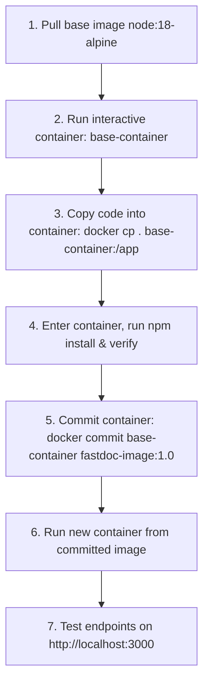

# fastdoc - Student Management API

**Repository URL:** [https://github.com/Eitacee/fastdoc](https://github.com/Eitacee/fastdoc)  
**Student Name:** Prince Kandari  
**SAP ID:** 590014595  
**Course:** Backend Development  

---

> 🔗 **Standalone Repository:**  
> The complete source code, package configuration, and container workflow for this task are maintained in the dedicated repository:  
> 👉 **[https://github.com/Eitacee/fastdoc](https://github.com/Eitacee/fastdoc)**

---

A lightweight RESTful Student Management API built with Node.js and Express, configured for both local development and containerization via a manual **`docker commit`** workflow.

---

## 📋 Features

- **Express.js API**: In-memory student data store.
- **Full CRUD Endpoints**:
  - `GET /` — Welcome message and API overview.
  - `GET /students` — Retrieve all student records.
  - `GET /students/:id` — Retrieve a single student by ID.
  - `POST /students` — Add a new student record (supports JSON body).
  - `DELETE /students/:id` — Remove a student record by ID.
- **Nodemon Integration**: Hot-reloading development server (`npm run dev`).
- **Production Server**: Simple startup script (`npm start`).
- **Docker Ready**: Step-by-step instructions for manual `docker commit` container creation.
- **GitHub Repository**: [https://github.com/Eitacee/fastdoc](https://github.com/Eitacee/fastdoc)

---

## 🚀 Getting Started Locally

### Prerequisites

- [Node.js](https://nodejs.org/) (v18 or higher recommended)
- [npm](https://www.npmjs.com/)

### 1. Clone & Enter the Repository

```bash
git clone https://github.com/Eitacee/fastdoc.git
cd fastdoc
```

### 2. Install Dependencies

```bash
npm install
```

### 3. Run the Development Server (with hot-reload)

```bash
npm run dev
```

The server will listen at:
```
http://0.0.0.0:3000
```
or accessible at `http://localhost:3000`.

### 4. Run the Production Server

```bash
npm start
```

---

## 📡 API Endpoints & Testing

### 1. Welcome Message
- **Method:** `GET`
- **URL:** `http://localhost:3000/`
- **Response:**
  ```json
  {
    "message": "Welcome to the Student Management API!",
    "version": "1.0.0",
    "endpoints": {
      "GET /": "Welcome message and API overview",
      "GET /students": "Get all students",
      "GET /students/:id": "Get a student by ID",
      "POST /students": "Create a new student (JSON body)",
      "DELETE /students/:id": "Delete a student by ID"
    }
  }
  ```

### 2. Get All Students
- **Method:** `GET`
- **URL:** `http://localhost:3000/students`
- **Response:**
  ```json
  [
    { "id": 1, "name": "Prince Kandari", "course": "Computer Science", "age": 21 },
    { "id": 2, "name": "Alice Smith", "course": "Data Science", "age": 22 },
    { "id": 3, "name": "Bob Johnson", "course": "Cyber Security", "age": 20 }
  ]
  ```

### 3. Get Student by ID
- **Method:** `GET`
- **URL:** `http://localhost:3000/students/1`
- **Response:**
  ```json
  {
    "id": 1,
    "name": "Prince Kandari",
    "course": "Computer Science",
    "age": 21
  }
  ```

### 4. Add a New Student
- **Method:** `POST`
- **URL:** `http://localhost:3000/students`
- **Header:** `Content-Type: application/json`
- **Body:**
  ```json
  {
    "name": "Charlie Brown",
    "course": "Information Technology",
    "age": 23
  }
  ```
- **Response:**
  ```json
  {
    "message": "Student added successfully",
    "student": {
      "id": 4,
      "name": "Charlie Brown",
      "course": "Information Technology",
      "age": 23
    }
  }
  ```

### 5. Delete a Student
- **Method:** `DELETE`
- **URL:** `http://localhost:3000/students/2`
- **Response:**
  ```json
  {
    "message": "Student deleted successfully",
    "student": {
      "id": 2,
      "name": "Alice Smith",
      "course": "Data Science",
      "age": 22
    }
  }
  ```

---

## 🐳 Step 5 — Docker Manual `docker commit` Workflow

This practical emphasizes creating a custom Docker container image using the manual container snapshot workflow (`docker commit`) instead of an automated `Dockerfile`.

### Workflow Walkthrough



### Complete Commands:

#### 1. Run a base container from Node.js Alpine
```bash
docker run -it -d --name fastdoc-builder -p 3000:3000 -w /app node:18-alpine sh
```

#### 2. Copy the application files into the container
```bash
docker cp . fastdoc-builder:/app
```

#### 3. Install production dependencies inside the container
```bash
docker exec -it fastdoc-builder npm install --production
```

#### 4. Commit the container to create a new custom Docker image
```bash
docker commit -c "WORKDIR /app" -c "CMD node app.js" fastdoc-builder fastdoc-image:latest
```

#### 5. Stop and clean up the builder container
```bash
docker stop fastdoc-builder
docker rm fastdoc-builder
```

#### 6. Run a container from your newly committed image
```bash
docker run -d --name fastdoc-app -p 3000:3000 fastdoc-image:latest
```

#### 7. Verify the running container and API
```bash
# Check container status
docker ps

# Check container logs
docker logs fastdoc-app

# Test the API endpoints
curl http://localhost:3000/
curl http://localhost:3000/students
```

#### 8. Stop / Restart the container when needed
```bash
# Stop container
docker stop fastdoc-app

# Start container again
docker start fastdoc-app

# Remove container
docker rm -f fastdoc-app
```

---

## 📂 Project Structure

```
fastdoc/
├── .gitignore          # Ignores node_modules and logs
├── app.js              # Express.js server & in-memory Student Management API
├── package.json        # Project metadata, dependencies, and start/dev scripts
├── package-lock.json   # Exact dependency lockfile
└── README.md           # Documentation, API specifications, and Docker commit instructions
```

---

## 🔗 Repository Reference

- **GitHub Repository**: [https://github.com/Eitacee/fastdoc](https://github.com/Eitacee/fastdoc)
- **Clone URL**: `git clone https://github.com/Eitacee/fastdoc.git`
- **Main Coursework Portfolio**: [https://eitacee.github.io/Backend-development/](https://eitacee.github.io/Backend-development/)
